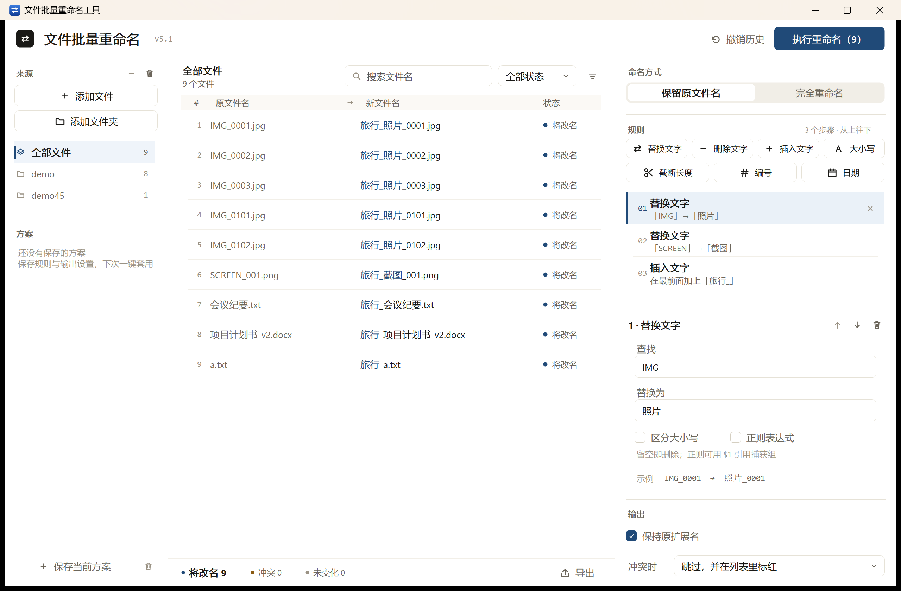

# 文件批量重命名工具

Windows 上的批量改名工作台：左边放文件，中间一列原名一列新名地校对，右边用可增删的规则链算出新名字，确认后一次落盘，随时可撤销。

- 原生 WinForms，.NET Framework 4.x，单文件 exe，无第三方依赖
- 7 类规则步骤（替换 / 删除 / 插入 / 大小写 / 截断 / 编号 / 日期）从上到下依次执行
- 模板起名：`{name}` `{ext}` `{n}` `{nn}` `{date}` `{parent}`
- 两阶段改名（先临时名再目标名），A↔B 互换不会互相覆盖；每次执行写撤销日志
- 实时预览、状态筛选、搜索、拖拽排序、CSV 清单导出



## 运行

双击 `文件批量重命名工具_*.exe` 即可，免安装。数据目录优先 `%LOCALAPPDATA%\FileBatRenamer`，不可写时退到 exe 同目录的 `FileBatRenamer.data`。

完整说明见 [使用说明_20261109_v10.md](使用说明_20261109_v10.md)。

## 构建

需要 Windows + 系统自带的 .NET Framework 4.x 编译器（`C:\Windows\Microsoft.NET\Framework64\v4.0.30319\csc.exe`），不需要 Visual Studio。

```powershell
# 编译，产物落在仓库根目录：文件批量重命名工具_YYYYMMDD_<Version>.exe
.\build\build-native.ps1 -Version v5.1

# 编译后跑引擎自检与界面冒烟测试
.\build\build-native.ps1 -Version v5.1 -Verify
```

`-Sign` 会用 `cert\FileBatRenamer_Local.pfx` 做本地签名；该证书含私钥，**不在仓库里**，没有证书时去掉 `-Sign` 即可。

签名口令不写进仓库：优先 `-CertPassword`（`sign-exe.ps1` 里是 `-Password`），其次环境变量 `FBR_CERT_PASSWORD`，都没有时在交互终端里安全输入。无人值守构建请用环境变量，别把口令写进脚本或提交记录。

## 测试

```powershell
.\文件批量重命名工具_*.exe -SelfTest   # 引擎：文件读取、规则、冲突、两阶段改名、撤销、回滚
.\文件批量重命名工具_*.exe -UiTest     # 界面：列表、规则编辑、筛选、方案、CSV、版式约束
```

当前 v5.1：引擎 51 项、界面 41 项，全部通过。

## 目录

```
native\      源码（Core / Ops / Theme / Controls / MainForm / Features / Program）
build\       构建、截图、图标、签名脚本与界面截图
工具\        安装/卸载信任证书、解除文件锁定的快捷脚本
```

## 隐私

- 全程离线：不联网、不读取文件内容、不上传文件名或路径。
- 设置、方案、撤销日志只写本机数据目录（`%LOCALAPPDATA%\FileBatRenamer` 或 exe 同目录的 `FileBatRenamer.data`），删掉目录即清空。
- 仓库不含任何证书私钥；`cert/` 已被 `.gitignore` 排除，签名口令只从参数、环境变量或终端输入，不落盘。
- 界面截图使用虚构的演示文件（`IMG_0001.jpg`、`会议纪要.txt` 等），不含真实路径或个人信息。

## 版本

v5.1（2026-11-09）：中栏改为与左右栏对齐的通高白栏；新文件名只把真正变化的一段标成墨蓝；列表刷新去抖 + 双缓冲 + 列宽守卫，修输入与滚动时的闪烁。
